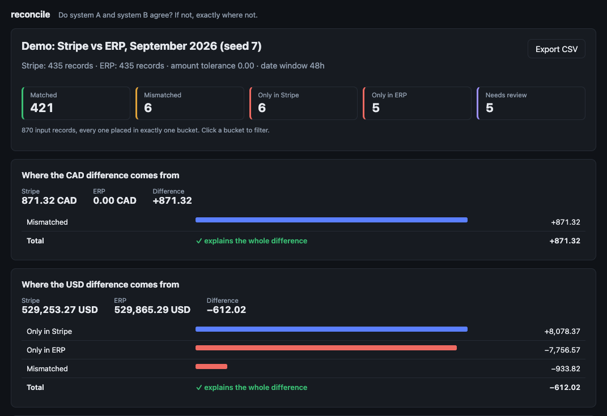
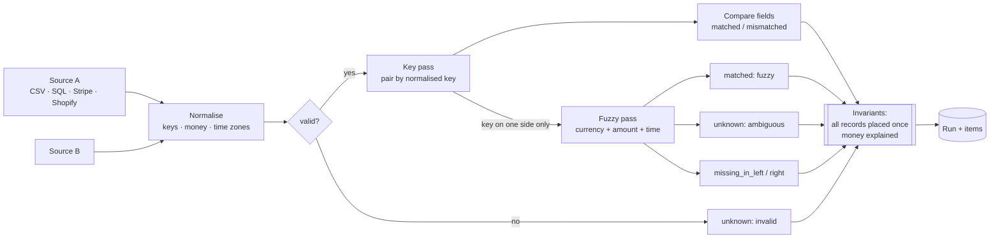

# reconcile

**Do system A and system B agree? If not, exactly where not — down to the cent.**

Stripe says $48,210 came in this month. The ERP says $47,960. Finance wants to know which orders
make up the $250 before they close the books. Most teams answer that with a spreadsheet and an
afternoon. `reconcile` answers it in a second, and proves the answer adds up.



## What it does

- Pulls records from two systems — **CSV, any SQL database, Stripe, Shopify** — through small
  declarative connectors.
- Normalises the things that make correct systems look wrong: `SO-0010042` vs `so10042`,
  naive local timestamps vs UTC, `"1,204.50"` vs `120450` minor units, zero-decimal currencies.
- Matches in two passes: by **key**, then **fuzzy** (same currency, amount within tolerance,
  time within a window) for rows that lost their reference.
- Puts **every input record in exactly one bucket**:

  | Bucket | Meaning |
  |---|---|
  | `matched` | Same record on both sides (by key, or fuzzy with a confidence score) |
  | `mismatched` | Same key, but amount / currency / date disagree — with the reason |
  | `missing_in_right` / `missing_in_left` | Exists on one side only (incl. duplicate postings) |
  | `unknown` | Cannot be placed with confidence: ambiguous candidates or unparseable rows |

- **Explains the money**: for each currency, the difference between the two totals is broken
  down by bucket, and the parts are checked to sum to the whole.

## Guarantees

These are enforced in code (`engine.py`) and fail loudly, not logged and ignored:

1. **Nothing is dropped.** Every input record appears in exactly one outcome; otherwise
   `InvariantError`.
2. **The money balances.** Σ bucket contributions = left total − right total, per currency,
   exactly (Decimal, no floats).
3. **No guessing.** When two candidates are equally good, both sides go to `unknown`
   instead of picking one. A wrong match hides a real problem; an honest "unknown" surfaces it.
4. **Idempotent runs.** A run is fingerprinted from its inputs + rules (unique constraint). Submitting the same files
   again returns the existing run (also under concurrent requests).

## How it works



**Fuzzy pass.** The right side is indexed by currency and sorted by amount; each left record
binary-searches the slice within the amount tolerance, so the cost is driven by the number of
plausible candidates, not n × m. Candidates are scored on amount and time closeness and assigned
greedily, best first; a candidate is only accepted if it beats every free rival by
`ambiguity_margin`. Two records that both carry a key and disagree on it are never fuzzy-matched.

**Measured on an Apple M1:** 100,070 records with keys in 0.29 s; 20,000 × 20,000 records with
*no* keys at all (worst case, every row goes through the fuzzy pass) in 0.10 s.

## Proving it works

- **Planted-error demo.** `reconcile demo` generates a month of 435 Stripe charges and 435 ERP
  orders with known problems: never-booked payments, unpaid orders, discounts applied on one side,
  a CAD/USD mix-up, a double posting, charges that lost their order reference, two
  indistinguishable charges, a corrupt row, and orders placed late in the evening in Los Angeles
  (a different calendar day in UTC). The test suite requires the engine to label **every** record
  exactly as planted, across several seeds. With fuzzy matching switched off the same check
  mislabels 10 of 435 Stripe rows — so the test can fail.
- **Property-based tests** (Hypothesis) throw random records, duplicate keys, missing fields,
  mixed currencies and tolerances at the engine and assert the guarantees above.
- **Connector tests** run against mocked Stripe / Shopify APIs (pagination, failed charges,
  cancelled orders, zero-decimal currencies) and a real SQLite database.
- `ruff`, `mypy --strict` and the full suite run in CI.

## Quick start

```bash
docker compose up --build        # http://localhost:8080 → "Run the demo"
```

Or locally:

```bash
cd backend && uv sync && uv run uvicorn reconcile.api:create_app --factory   # :8000
cd frontend && pnpm install && pnpm dev                                      # :5173
```

### CLI

```bash
uv run reconcile demo --dir demo-data
uv run reconcile run demo-data/job.yaml --out outcomes.csv --strict
```

```
Stripe vs ERP, September 2026
Stripe: 435 records   ERP: 435

  matched               421
  mismatched              6
  missing_in_right        6
  missing_in_left         5
  unknown                 5

USD: Stripe 529,253.27  ERP 529,865.29  difference -612.02
  missing_in_right        8,078.37
  missing_in_left        -7,756.57
  mismatched               -933.82
```

`--strict` exits with status 2 when anything is not matched, so the command can gate a nightly
job or a month-end close checklist.

### Job file

```yaml
name: Stripe vs ERP, October
left_label: Stripe
right_label: ERP
left:
  type: stripe                   # key read from $STRIPE_API_KEY (use a restricted, read-only key)
  start: 2026-10-01T00:00:00Z
  end: 2026-11-01T00:00:00Z
right:
  type: sql
  url_env: ERP_DATABASE_URL      # read-only role
  query: >
    select tranid, otherrefnum, total, currency, trandate
    from transactions where trandate >= :start and trandate < :end
  params: { start: "2026-10-01", end: "2026-11-01" }
  fields:
    id: tranid
    key: otherrefnum
    amount: total
    currency: currency
    occurred_at: trandate
    timezone: America/Los_Angeles
rules:
  amount_tolerance: "0.01"
  date_window_hours: 72
```

Secrets are only ever read from environment variables, never from the job file.

## API

| Method | Path | |
|---|---|---|
| `POST` | `/api/runs` | Multipart: two CSVs + JSON column mappings + rules. `201` new, `200` if identical run exists |
| `POST` | `/api/runs/demo` | Reconcile the generated demo month |
| `GET` | `/api/runs` · `/api/runs/{id}` | Run summary: bucket counts, per-currency explanation |
| `GET` | `/api/runs/{id}/items?bucket=&limit=&offset=` | Outcomes, largest difference first |
| `GET` | `/api/runs/{id}/export.csv` | Streaming export (identifiers escaped against CSV formula injection) |

Uploads are size-capped (`RECONCILE_MAX_UPLOAD_MB`), and the API only accepts uploaded files —
it never reads paths or connection strings from a request.

## Project layout

```
backend/src/reconcile/
  domain.py        Records, buckets, reasons, results (immutable, Decimal money)
  normalize.py     keys, amounts, currencies, time zones
  engine.py        key pass, fuzzy pass, invariants, money explanation
  connectors/      csv, sql, stripe, shopify
  config.py        YAML job spec → sources
  storage.py       SQLAlchemy models, fingerprinting, queries
  api.py           FastAPI app
  cli.py           Typer CLI
  demo.py          labelled synthetic data
frontend/          React + TypeScript dashboard (Vite)
```

## Limits and next steps

- Matching is one-to-one. One payout covering many orders (Stripe payouts, bank deposits) needs
  a many-to-one grouping pass — the next feature.
- Fees are not modelled: reconcile charges (gross) against orders, or balance transactions (net)
  against payouts.
- Runs are synchronous; very large sources should move to a background worker.

## License

MIT
